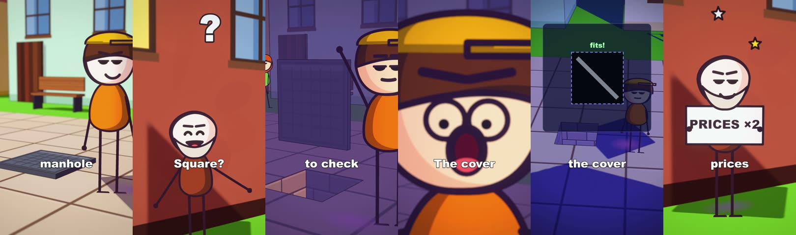
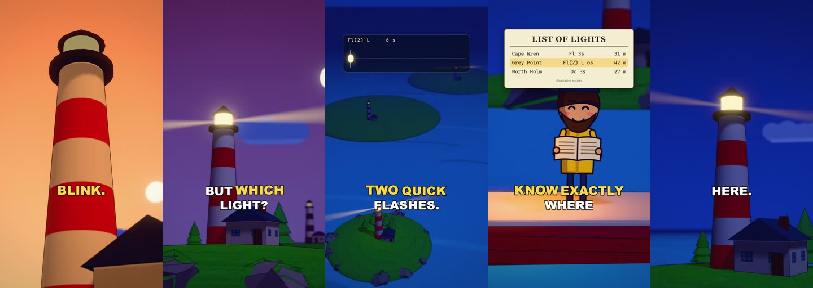
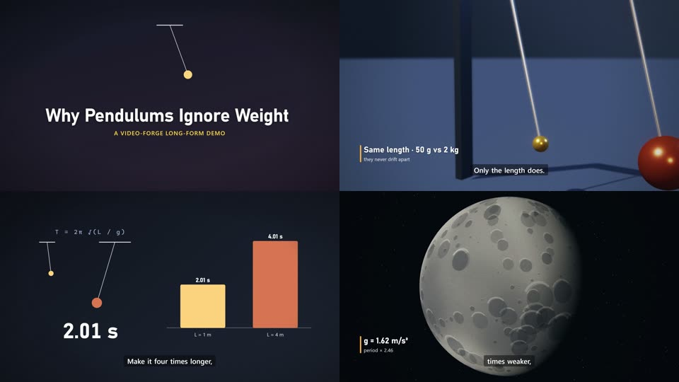

# video-forge: reverse-engineer videos, then render better ones (2K/4K)

A Claude Skill that turns *"analyze this video, understand exactly how it was made, and create something even better"* into a working pipeline:

1. **Measure** any video, YouTube link or channel frame by frame at native fps:
   - camera path, zoom, easing and jerk; cuts and shot lengths
   - grade (black floor, shadow and highlight tints), ink lines, depth of field, grain, micro-motion
   - loudness, tempo, speech rate, the hook
2. **Produce** original videos with a deterministic **Remotion + three.js** engine, rendered **natively** at:
   - 2560x1440 / 3840x2160 (YouTube)
   - 1440x2560 / 2160x3840 (Shorts, TikTok, Reels)
   - 30 or 60 fps

   It includes inked or cinematic 3D worlds, consistent 2D characters, camera grammar, kinetic typography, word-synced captions, transitions, synthesized SFX and score, and mastered audio (-14 LUFS / -1 dBTP).
3. **Verify** with an automated QA gate and a reference gap analysis: your render goes through the same analyzer, and the delta is the to-do list.



The image above is the demo "Why manhole covers are round". It is 9:16 1440x2560 and was built from a measured 149-short channel study (`references/styles/toonworld-explainer.md`). It uses:
- toon shaders and per-beat lighting
- follow-cam down the shaft with motion blur
- one-word captions
- section-arranged sound

| | |
|---|---|
|  |  |
| demo short, 1440x2560, inked 3D, 23 s | demo long-form, 2560x1440 and 3840x2160, chaptered |

## What's in the box

```
skill/video-forge/            <- the Claude Skill (copy this folder into your skills directory)
  SKILL.md                    entry point (modes, production loop, non-negotiables)
  references/                 workflow, analyzer, engine, board (storyboard as data), craft, quality, longform, external, reference-study
  analyzer/                   vfa: Python measurement toolkit (fetch, analyze, channel, compare, aggregate, qa, sbs)
  engine/                     Remotion + three.js production engine, render orchestrator, demo projects
  audio/                      sfx.py, music.py, tts.py (offline TTS + word alignment), tighten.py, score.py (sound from the picture), mix.py (mix + master)
  scripts/doctor.mjs          dependency checker
  templates/                  style bible, series bible
tests/                        ground-truth tests for the analyzer (synthetic videos with known motion/cuts)
docs/                         architecture, research notes, development guide
```

## Install

Requirements:
- **Node ≥ 18**
- **Python ≥ 3.10**
- **ffmpeg/ffprobe ≥ 6** with `ebur128`/`loudnorm`
- optional **yt-dlp** for URLs
- a GPU with WebGL for fast 3D rendering (works without one, slowly)

```bash
git clone https://github.com/noahbroeren/animation-skill
cd animation-skill
# Windows (PowerShell):  .\install.ps1        macOS/Linux:  ./install.sh
```

The installer:
1. copies `skill/video-forge` to `~/.claude/skills/video-forge`
2. installs Python requirements
3. runs `npm install` in the engine
4. runs the doctor

Manual install: copy the folder yourself, then run `pip install -r analyzer/requirements.txt` and `cd engine && npm install`.

## Use (just talk to Claude)

- "Analyze https://youtube.com/... at 30 fps and tell me exactly how it was made."
- "Study this channel's top 20 shorts and write the style bible."
- "Make a 45-second short in that style about <topic>, but better: native 2K, captions, sound design."
- "Turn this script into a 10-minute chaptered YouTube video in the documentary look, 4K."
- "My video looks cheap compared to this one. Measure both and fix it."
- "Here is a script. Make the short." (one command: `node tools/make.mjs --project ID`, see below)

Or drive the tools directly:

```bash
py skill/video-forge/analyzer/vfa.py analyze ref.mp4                    # measure
py skill/video-forge/analyzer/vfa.py compare ref_analysis ours_analysis # gap table
cd skill/video-forge/engine
node tools/make.mjs --project my-short                                  # script -> fact check -> voice -> storyboard -> stills -> audit -> render -> sound -> QA
node tools/make.mjs --project my-short --from board --to stills         # the authoring loop: one named still per beat
node tools/make.mjs --project my-short --from audit --also long        # + thumbnails, ranked title variants and the 16:9 version from the same storyboard
node tools/new-project.mjs my-short --format short                      # scaffold a hand-built project instead
node tools/render.mjs --project lighthouse --format short --stills 0,200,400 --scale 0.5
node tools/render.mjs --project pendulum --format long4k --audio public/pendulum/master.wav
py ../analyzer/vfa.py qa out/.../pendulum_3840x2160_30fps.mp4 --plan out/.../timeline.json --min-class 4k
```

## Status: what is functional, experimental, or external

| capability | status |
|---|---|
| frame-accurate analysis (camera incl. zoom/roll, easing, jerk, cuts, grade, tints, ink, DOF, grain, activity, native-detail, loudness, onsets, BPM, speech metrics) | **functional, tested** (ground-truth tests; run on a 21,361-frame reference) |
| YouTube/channel download with original audio + subtitles, channel aggregation | functional (needs yt-dlp; respects what's publicly accessible) |
| gap analysis (`compare`) and QA gate (`qa`) | **functional, tested** on the demo renders |
| engine: native 2K/4K, 30/60 fps, chunked resumable renders, ink/DOF/bloom/grade/grain post, camera rig, world kit, 2D character cards with shadows, captions, titles, charts, transitions | **functional, tested** (demo short 1440x2560; demo long-form 2560x1440 and 3840x2160) |
| procedural SFX, score bed, two-pass loudness mastering, voice-keyed ducking | functional, tested (-14.0 LUFS / -1.0 dBTP measured) |
| offline TTS (Windows SAPI / macOS `say` / espeak) + faster-whisper word alignment | functional; OS voices sound robotic |
| premium voice (ElevenLabs etc.), AI video plates, Blender photoreal, AI upscalers | **external**: documented integration paths in `references/tools/external.md`, cost confirmation required |
| channel study (`vfa batch`, eras, views correlation) + sentence breakdowns (`vfa breakdown`) | **functional, tested** on 42 shorts of a 149-short channel |
| toon shaders (painted cel world, card shading, wind, water), camera motion blur, DOF v2, knot grade, FX, one-word captions | **functional, tested** in the `manhole` demo (1440x2560, QA WARN with no FAIL) |
| audio DSP (BS.1770 loudness, true-peak limiter, words-keyed ducking, sections, reverb, distance) | **functional, tested** (`tests/test_audio.py`; ffmpeg cross-check on every mix) |
| **storyboard as data** (`lib/board.tsx`): beats on spoken words drive camera, light plan, acting, gags, crowds, shot audit and the sound cue sheet; `make.mjs` runs the whole chain with gates | **functional, tested** on the `coins` short (41 beats, 8 sets, 1440x2560) |
| ready-made sets with marks (8 sets, old / modern, day / night), shot grammar (11 sizes incl. point-of-view, 7 moves, whip), vehicles with seated characters, rain + wet-ground reflection, three-quarter view, smear frames, reacting crowds | **functional**, checked on sheets (`setsheet`, `propsheet`, charsheet still 310) and in the `coins` short |
| sound from the picture (`audio/score.py`): real samples first, synthesized fallback, music track, ambience per place, rain | functional; the sample library itself is local (`~/.video-forge/sounds/`, prompts in `audio/soundlib.json`), never in this repository |
| automatic dissolve/transition classification, OCR/font identification, 60 fps demo render, side-view walk cycles, crowds pool | not implemented / not yet verified |

## Measured performance (RTX 5070, 16 threads)

| task | result |
|---|---|
| analyze 12 min 1440p video, every frame | 306 s (≈ 70 fps) |
| render inked 3D short 1440x2560, 23 s | ≈ 45 s (≈ 17 fps) |
| render long-form 2560x1440, 31.6 s | ≈ 60 s (≈ 15 fps) |
| render long-form 3840x2160, 31.6 s | ≈ 141 s (≈ 7 fps) |

## Documentation

- [`skill/video-forge/SKILL.md`](skill/video-forge/SKILL.md): how Claude uses the skill
- [`docs/ARCHITECTURE.md`](docs/ARCHITECTURE.md): design decisions and data flow
- [`docs/RESEARCH.md`](docs/RESEARCH.md): reference-video study, ZIP analysis, technology choices
- [`docs/DEVELOPMENT.md`](docs/DEVELOPMENT.md): tests, adding looks/props/projects, releasing

## License

MIT (see `LICENSE`). Adapted techniques from other MIT projects are credited in `THIRD_PARTY_NOTICES.md`. Remotion has its own license: free for individuals and small teams; companies above its threshold need a Remotion company license (https://remotion.dev/license).
